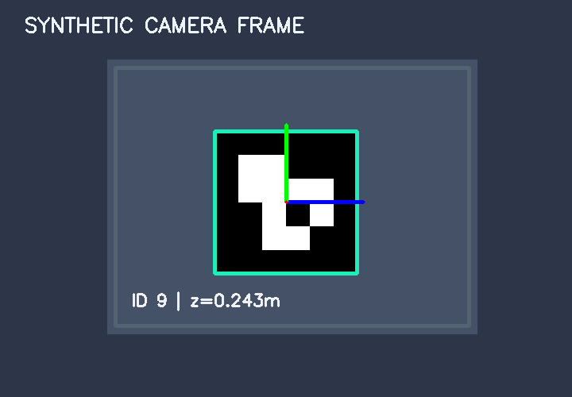

<div align="center">

# ArUco Vision-Guided Robotics

### Marker Pose Estimation · Calibrated Frame Transforms · ROS 2 Visualization

**Hazem Nefzi · Robotics & Computer Vision · v2.0**

Estimate where a marker is relative to a calibrated camera, express its pose in a robot frame, and publish the result for visualization in ROS 2.

[Quick start](#quick-start) · [How it works](#how-it-works) · [ROS 2 integration](#ros-2-integration) · [Validation](#validation-and-design-notes)

</div>



> [!NOTE]
> This portfolio project uses synthetic examples to demonstrate the vision pipeline. The results illustrate its behavior under controlled conditions. See the validation report for the tested scenarios and their limits.

## Quick start

Create and activate an isolated Python environment. For Windows instructions, see the [installation guide](docs/INSTALL.md). Then run these commands from the repository root:

```bash
python -m pip install -e ".[dev]"
python -m robotics_vision.demo --output outputs
python -m pytest -q
```

The demo saves its results in `outputs/`, including `poses.json` for the ROS 2 example below.

## How it works

| Stage | What happens |
| --- | --- |
| **1 · Detect the marker** | Identify the ArUco marker and locate its four corners in the image. |
| **2 · Estimate the pose** | Use the corner locations, camera calibration, and known marker size to estimate the marker’s position and orientation relative to the camera. |
| **3 · Report pose ambiguity** | A flat square marker can admit more than one plausible pose. The pipeline reports ambiguity when the image evidence leaves competing solutions. |
| **4 · Compose coordinate frames** | Combine the marker pose in the camera frame with the calibrated camera-to-base transform to express the marker pose in the robot base frame. |
| **5 · Visualize in ROS 2** | Publish the saved pose from the demo so it can be inspected in a ROS 2 setup. |

The frame composition follows this order:

```text
T_base_marker = T_base_camera @ T_camera_marker
```

Here, `T_base_camera` maps camera coordinates into the base frame, and `T_camera_marker` maps marker coordinates into the camera frame.

## ROS 2 integration

After running the Python demo, open a terminal with your ROS 2 environment sourced and run this from the repository root:

```bash
python ros2_publish_pose.py --pose outputs/poses.json
```

This example publishes a pose from a saved JSON file for visualization. See [detailed usage](docs/USAGE.md) for the expected inputs and integration setup.

## Tests and checks

| Check | Command |
| --- | --- |
| Full regression suite | `python -m pytest -q` |
| Focused robustness tests | `python -m pytest tests/test_robustness.py -q` |
| Static code checks | `python -m ruff check .` |

## Project layout

| Path | Contents |
| --- | --- |
| `robotics_vision/` | Python vision package and synthetic demonstration |
| `configs/` | Project configuration files |
| `ros2_publish_pose.py` | ROS 2 publisher for saved pose results |
| `tests/` | Regression and robustness tests |
| `assets/` | Demo image and supporting assets |
| `docs/` | Installation, usage, design, and validation notes |

## Validation and design notes

- [Validation report](docs/VALIDATION.md) covers the executed checks, test environment, and limitations.
- [Design decisions](docs/DESIGN.md) explains the algorithms, assumptions, and failure modes.
- [Detailed usage](docs/USAGE.md) documents workflows and expected inputs.
- [System card](docs/SYSTEM_CARD.md) describes the intended use and evaluation boundaries.
- [Contributing guide](CONTRIBUTING.md) describes development and review expectations.

## Attribution and license

Developed with AI assistance. The original synthetic examples are independent of confidential internship and research work. The original code is available under the [MIT license](LICENSE).
